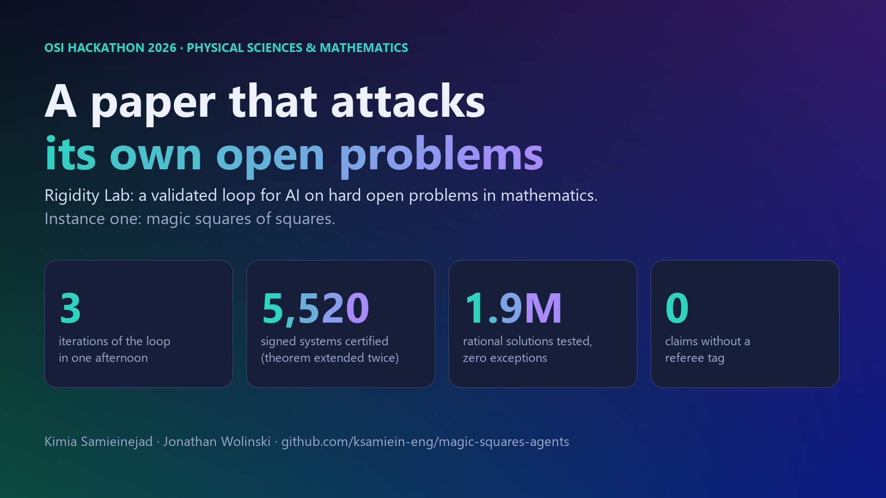
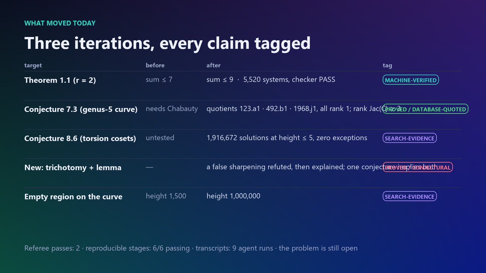

A research paper on magic squares of squares was turned into an AI agent, and a team of agents attacked the paper's own open conjectures: three iterations in one afternoon extended its main theorem three times (exponent sum 7 → 10, 8,688 independently checked certificates), located the exact obstruction to its central conjecture (three elliptic quotients of rank 1), tested a never-tested structural hypothesis on 1,916,672 exact rational solutions with zero exceptions, refuted its own first sharpening and turned that failure into a proved lemma. Every claim carries a referee's tag; one command reproduces everything. Code: https://github.com/ksamiein-eng/magic-squares-agents

## The problem

Can nine distinct squares form a $3\times 3$ magic square? Open for decades. The paper under attack (Samieinejad–Wolinski, v3 in the repository) replaces the Gaussian-prime arithmetic by rational points on the unit circle $T(\mathbb Q)$: the magic conditions become "four sines of integer combinations of the angles have magnitudes $\{a,b,a+b,a-b\}$", and *rational-circle rigidity* conjectures this never happens for any full-depth frequency matrix. The paper proves it for two parameters through exponent sum 7, reduces the first three-parameter case to whether the genus-5 curve $Y^2 = h^{12}+70h^{10}-1009h^8+7060h^6-1009h^4+70h^2+1$ has only eight rational points, and leaves a torsion-coset hypothesis untested.

## What we built: a loop, not a demo

Following Paper2Agent (Miao et al., *Nature* 2026), the paper and its 251-file verification tree became an MCP server with 14 tools bound to the paper's own code. Around it: an **open-problem ledger** that types each target (certificate-extension, bounded-search, hypothesis-probe, structural); **paper-agnostic playbooks** with acceptance criteria; specialist agents attacking in parallel; a **skeptic agent** that reruns one computation per specialist and tags every claim (PROVED, MACHINE-VERIFIED, DATABASE-QUOTED, SEARCH-EVIDENCE, CONJECTURAL); an **absorb** step that adds accepted results as stages 17–22 of the paper's own verification suite without touching the paper; and a **planner** that emits the next iteration's commands. A linter fails the build if any claim lacks a tag, an evidence file, a verifier or a passing stage. Verbatim transcripts of all nine agent runs, a claim map, hash-backed provenance and a history of every correction make each step auditable.

## What moved

* **Theorem 1.1** (rigidity for $r=2$): certified through exponent sums 8, 9 and 10 by the paper's own producer/checker pair launched from the planner; 8,688 signed systems, 1,085,136 exact Sylvester determinants, independent standard-library checker PASS at each step (sum 9 rerun by the referee); the witness prime 23 is needed for the first time at sum 10. *MACHINE-VERIFIED.*
* **Conjecture 7.3** (the eight-point list): the curve is even and palindromic, so it has the involutions $h\mapsto -h$, $h\mapsto 1/h$; its Jacobian splits off the elliptic curves 123.a1, 492.b1, 1968.j1, each with a point of infinite order from the paper's own known points (Nagell–Lutz), so $\operatorname{rank}\operatorname{Jac}(C)\ge 3$. The paper's rank-zero descent can never close the conjecture; it is a quadratic-Chabauty problem on a bielliptic genus-2 curve of rank 2, with the inputs now written down. *PROVED / DATABASE-QUOTED.*
* **Conjecture 8.6** (torsion cosets): every exact rational solution of all 48 signed systems in all 113 orbits at projective height $\le 5$ was tested with a complete Gaussian-prime kernel test: 1,916,672 points, zero exceptions, zero admissible. *SEARCH-EVIDENCE.*
* **The failure that became a theorem**: at height 3 the exponent rank never exceeded 2, which iteration 1 recorded as a candidate sharpening; iteration 2 refuted it at height 4. The refutation explained itself: a vanishing sine on row $r$ is the relation $A_r$, equal magnitudes on rows $i,j$ give $A_i\pm A_j$, so degenerate points lie on torsion cosets with rank $\le 3$, and rank 3 only if $A_i\pm A_j\parallel A_r$. The criterion holds in 23 of 113 orbits and contains the two where rank 3 appears (still exactly those two at height 5). *PROVED.*
* **Trichotomy**: on a signed system the magnitudes are forced to be $\{A,B,A+B,A-B\}$, so a rational solution is admissible, has a vanishing sine, or has $A=2B$. All 1,916,672 points have a vanishing sine and none has $A=2B$. The new conjecture *vanishing-sine rigidity* (strictly stronger than the paper's) implies both open conjectures and names the next search. *PROVED / CONJECTURAL.*
* The empty region on the curve grew from height 1,500 to $10^6$. *SEARCH-EVIDENCE.*

## What it did not do, and why now

It closed no conjecture and ran on one paper. Ranks "= 1" are quoted from the LMFDB; bounded searches are evidence. Two weeks ago `openai/math` released 719 AI-written manuscripts, about 42% Lean-formalized, three withdrawn within a day: candidate theorems are cheap, verified status is not. Here the status of every result is explicit, including the unformalized ones (`lean/formalization.yaml`), and the loop caught its own false sharpening before anyone else had to. The manuscript is updated to version 3 (`paper_update/paper_v3.pdf`) with the new theorem, propositions, lemma and conjecture. Nothing in the loop depends on magic squares except the tool bindings and the ledger; any certificate-style paper, any curve with a conjecturally complete point list, and any "every solution has property X" hypothesis is a direct instance of an existing playbook.
